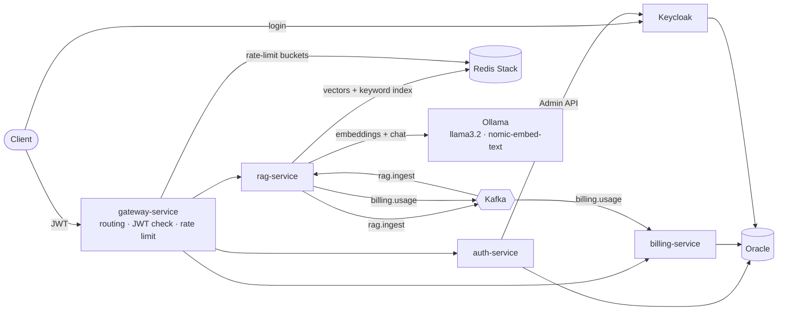
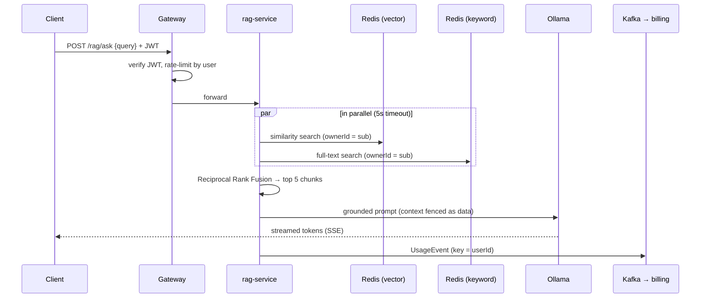

# RAG Microservices

A multi-tenant **Retrieval-Augmented Generation (RAG)** platform built as Spring Boot microservices.
Users upload their own PDF/DOCX documents and ask questions about them. Answers are streamed from a
**local LLM** (Ollama), grounded only in that user's documents, with chunk citations. Usage is
metered asynchronously for billing.


---

## Highlights

- **Hybrid retrieval**: semantic vector search and keyword search run in parallel and are fused
  with **Reciprocal Rank Fusion (RRF)**, which ranks better than either search alone.
- **Per-user data isolation**: every chunk carries an `ownerId`, and both searches filter on it on the server,
  so one user's documents can never show up in another user's answers.
- **Streaming answers**: tokens are streamed over Server-Sent Events.
- **Prompt-injection hardening**: retrieved text is fenced as data, the model must cite chunks
  and is allowed to answer "not found" rather than guess.
- **Asynchronous ingestion**: uploads return `202 Accepted` at once. A Kafka worker parses, chunks,
  embeds and indexes the file. Re-uploading the same file is idempotent (SHA-256).
- **Event-driven billing**: answers publish `UsageEvent`s; billing consumes them **exactly once**
  (idempotent consumer with a processed-events table).
- **Security**: Keycloak (OIDC/JWT) identity, an API gateway with per-user rate limiting, identity
  always taken from the signed token, no card data or passwords stored.
- **Production-minded**: Flyway migrations, validated configuration, health checks,
  Prometheus metrics, distributed tracing, non-root containers and CI.

---

## Architecture



| Service | Port (internal) | Responsibility |
|---|---|---|
| `gateway-service` | **8000 (public)** | Single entry point: routes `/auth`, `/billing`, `/rag`; validates JWTs; Redis-backed rate limiting |
| `auth-service` | 8081 | Sign-up (saga with compensation against Keycloak), user listing |
| `billing-service` | 8082 | Payments (provider tokens only), usage metering from Kafka |
| `rag-service` | 8083 | Document ingestion, hybrid search, streamed LLM answers |
| `common` | – | Shared JWT→role mapping, security defaults, Kafka event contracts |

Only the gateway (8000) and Keycloak (8080, for login) are published. Oracle, Redis, Kafka and
Ollama are reachable only on the internal Docker network.

---

## How a question is answered



The query path is **stateless**: no in-memory session and no broker round-trip, so any rag-service
instance can serve any request and the service scales horizontally. Kafka is used only where
asynchronous work makes sense: ingestion and metering.

### Ingestion

1. `POST /rag/documents` checks the file type, hashes it, stores the original and records it as `PENDING`.
   Then it publishes `IngestRequested` (key = documentId) and returns `202`.
2. `IngestWorker` extracts the text (PDFBox / Apache POI) and splits it into sentence-aligned chunks of about 1,200 characters with a
   150-character overlap. It tags each chunk with `ownerId`, `documentId` and `fileName`, then embeds and indexes it.
3. The status becomes `READY` (or `FAILED` with the reason). Jobs are idempotent: Kafka may deliver one twice, and the worker handles that safely.

---

## Tech stack

**Backend:** Java 17 · Spring Boot 3.5 · Spring AI 1.1 · Spring Cloud Gateway · Spring Security (OAuth2 resource server and client) · Spring Kafka · Spring Data JPA · Project Reactor
**AI / search:** Ollama (llama3.2, nomic-embed-text) · Redis Stack (RediSearch vector and full-text) · Apache OpenNLP · PDFBox · Apache POI
**Data / messaging:** Oracle XE 21 · Flyway · Apache Kafka 4 (KRaft)
**Identity:** Keycloak 26
**Ops:** Docker Compose · Micrometer (Prometheus, OpenTelemetry tracing) · Spring Boot Actuator · GitHub Actions

---

## Getting started

### Prerequisites
- Docker with Compose v2
- JDK 17+ (only to build or run outside Docker)
- About 8 GB of free RAM (Oracle, Keycloak and Ollama)

### 1. Configure secrets
```bash
cp .env.example .env
# edit .env and set real passwords
```
`.env` is git-ignored. Compose refuses to start if a required variable is missing.

### 2. Start everything
```bash
docker compose up -d --build
```
On the first start, Oracle creates the per-service database users (`infra/oracle/init`). The Ollama
models are downloaded, and the app services wait until they are ready.

### 3. Configure Keycloak (one time)
Open http://localhost:8080 and sign in with the admin credentials from `.env`. Then:
1. Create the realm **`saas`**.
2. Create the client **`saas-auth`**: client authentication **on** and service accounts **on**
   (and *Direct access grants* on if you want to get test tokens with `curl`).
3. In that client, create the roles **`client_user`** and **`client_admin`**.
4. Under **Service account roles**, give `saas-auth` the `realm-management` roles `manage-users` and
   `view-clients`.
5. Copy the client secret and the client UUID (from the URL) into `.env` as
   `KEYCLOAK_CLIENT_SECRET` and `KEYCLOAK_CLIENT_UUID`, then run `docker compose up -d` again.

### 4. Try it
```bash
# Sign up (public, rate-limited per IP)
curl -X POST localhost:8000/auth -H 'Content-Type: application/json' \
  -d '{"username":"dana","email":"dana@example.com","phone":"+972501234567","password":"S3cure-pass"}'

# Get a token
TOKEN=$(curl -s localhost:8080/realms/saas/protocol/openid-connect/token \
  -d grant_type=password -d client_id=saas-auth -d client_secret=$KEYCLOAK_CLIENT_SECRET \
  -d username=dana -d password=S3cure-pass | jq -r .access_token)

# Upload a document -> 202 {id, status: PENDING}
curl -X POST localhost:8000/rag/documents -H "Authorization: Bearer $TOKEN" -F file=@handbook.pdf

# Check ingestion status
curl localhost:8000/rag/documents/<id> -H "Authorization: Bearer $TOKEN"

# Ask (streams the answer)
curl -N -X POST localhost:8000/rag/ask -H "Authorization: Bearer $TOKEN" \
  -H 'Content-Type: application/json' -d '{"query":"What is the vacation policy?"}'
```

### Local development
To run one service from your IDE against the containers, start the stack with the dev override.
It publishes the infrastructure ports on `127.0.0.1` only and adds Kafka UI on :8084.
```bash
docker compose -f docker-compose.yaml -f docker-compose.dev.yml up -d
./mvnw -pl rag-service -am spring-boot:run
```

---

## API

| Method | Path | Auth | Description |
|---|---|---|---|
| `POST` | `/auth` | public | Sign up |
| `GET` | `/auth` | `client_admin` | List users (from Keycloak) |
| `POST` | `/rag/documents` | user | Upload PDF/DOCX → `202` with document id |
| `GET` | `/rag/documents/{id}` | owner | Ingestion status |
| `DELETE` | `/rag/documents/{id}` | owner | Delete document, its chunks and file |
| `POST` | `/rag/ask` | user | Ask a question; SSE stream of the answer |
| `POST` | `/billing/newCustomer` | user | Create the caller's usage record (idempotent) |
| `POST` | `/billing/pay` | user | Record a payment with a provider token |

Every user-scoped operation takes the user from the JWT `sub` claim, never from the request body.

---

## Security design

| Concern | Approach |
|---|---|
| Identity | Keycloak is the only store of credentials and profile data. Services are stateless JWT resource servers. |
| Authorization | Client roles mapped to Spring authorities (`common/KeycloakJwtConverter`) and `@PreAuthorize`. Object-level checks use the token's `sub` (no IDOR). |
| Tenant isolation | `ownerId` metadata on every chunk; vector and keyword searches filter on it on the server. |
| Defence in depth | The gateway validates tokens, and every service validates them again. Infrastructure is not published. Redis requires a password. |
| Abuse / cost control | Redis token-bucket rate limits per user (`/rag`) and per IP (sign-up). |
| Payments | Only payment-provider tokens are accepted. Card numbers and CVCs never reach the system (keeps it out of PCI DSS scope). |
| Secrets | Everything is read from the environment (`.env`, git-ignored); nothing is in the code or the images. The Keycloak admin token lives only in memory. |
| LLM safety | Retrieved context is fenced and treated as data; answers must cite chunks or say "not found". |
| Containers | Non-root runtime user, minimal JRE base image. |

---

## Design decisions

- **Synchronous fan-out for queries, Kafka for background work.** The first version sent queries
  through Kafka and kept response streams in memory. That breaks as soon as there is a second instance, and
  it replayed old queries after a restart. Running the searches in parallel in the same process (`Mono.zip`) is simpler, faster and
  stateless. Kafka remains where its strengths matter: durable ingestion jobs and usage events.
- **Saga for sign-up.** Keycloak and Oracle can't share a transaction. If any step after the
  Keycloak user is created fails, the user is deleted (compensation), so no half-created accounts are left.
- **Idempotency everywhere Kafka delivers.** Usage events carry an `eventId` recorded in the same
  transaction as the charge. Ingestion skips `READY` documents and replaces existing chunks.
- **Exact money.** `BigDecimal` / `NUMBER(12,2)`, never `double`.
- **Schema as code.** Flyway migrations; Hibernate only validates (`ddl-auto=validate`).
- **Fail fast on bad config.** `@ConfigurationProperties` + `@Validated`, and `${VAR:?}` in compose.

---

## Observability

- Health: `/actuator/health/liveness` and `/actuator/health/readiness` (used by the compose health checks)
- Metrics: `/actuator/prometheus`, including a custom `rag.llm.latency` timer
- Tracing: Micrometer + OpenTelemetry bridge; trace IDs appear in every log line
- Each RAG request is logged with a `queryId`

---

## Project structure

```
.
├── common/              # shared security + Kafka event contracts
├── gateway-service/     # Spring Cloud Gateway (public entry point)
├── auth-service/        # sign-up, users (Keycloak Admin API)
├── billing-service/     # payments, usage metering
├── rag-service/         # ingestion, hybrid search, LLM answers
├── infra/oracle/init/   # creates per-service DB users on first start
├── docs/                # design review notes
├── Dockerfile           # one multi-stage Dockerfile for all services
├── docker-compose.yaml  # full stack (only 8000 and 8080 published)
└── docker-compose.dev.yml  # local debugging override
```

## Build and test

```bash
./mvnw verify                      # builds all modules and runs the tests
docker build --build-arg SERVICE=rag-service -t rag-service .
```
CI (GitHub Actions) runs the same on every push and pull request.

---

## Roadmap

- Integration tests with Testcontainers (Oracle, Redis, Kafka)
- S3/MinIO for uploaded files, so ingestion workers can run on several hosts
- Keycloak realm export, so setup is fully automatic
- Keycloak production mode with TLS; Kafka SASL authentication
- Outbox pattern for usage events (currently fire-and-forget after an answer completes)
